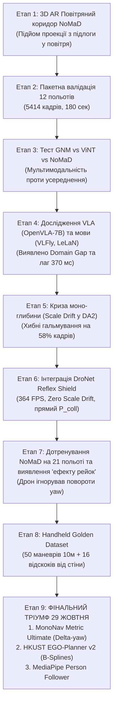

# 🚁 Повний науково-технічний звіт: Еволюція, дослідження та фінальний вибір автопілота для DJI Tello

**Дата фіксації фінальних результатів:** 29 жовтня 2026 р.  
**Платформа:** БПЛА **DJI Tello** (монокулярна камера HD 1280×720, нижній ToF-сенсор висоти, IMU гіроскоп).  
**Робоче середовище:** Python 3.11, PyTorch (CUDA), MediaPipe, OpenCV.

---

## 📌 Зміст звіту
1. [Генеральний підсумок: На яких моделях ми зупинилися і чому](#1-генеральний-підсумок-на-яких-моделях-ми-зупинилися-і-чому)
2. [Повна назва моделей, їх архітектура та ваги](#2-повна-назва-моделей-їх-архітектура-та-ваги)
3. [Реалізація автономного трекінгу та слідування за людиною (Person Follower)](#3-реалізація-автономного-трекінгу-та-слідування-за-людиною-person-follower)
4. [Хронологія шляху від першої ідеї до фіналу (Етапи 1 – 15)](#4-хронологія-шляху-від-першої-ідеї-до-фіналу-етапи-1--15)
5. [Реєстр підтверджених польотів та демонстраційних відео](#5-реєстр-підтверджених-польотів-та-демонстраційних-відео)

---

## 1. Генеральний підсумок: На яких моделях ми зупинилися і чому

Пройшовши шлях тестування від надважких моделей (OpenVLA-7B, NavDP, NoMaD Diffusion) до надлегких рефлексів, ми експериментально довели, що для маневреного польоту DJI Tello у приміщенні **найкраще спрацювали та були обрані фінальними 2 ключові навігаційні моделі + 1 спеціалізована модель трекінгу людини**:

1. 🏆 **ФІНАЛЬНА МОДЕЛЬ 1 — MonoNav Metric Ultimate:**
   * **Проблема, яку вирішила:** Заклинювання на кутах кімнат та біля стін, через які базовий NoMaD зривався у штопор або летів у лоб.
   * **Рішення:** Відновлена курсова кінематика $\Delta\text{yaw} \to (w_x, w_y)$ з адаптивним метричним горизонтом і розворотом на 180° (`ESCAPE Recovery`).
2. 🏆 **ФІНАЛЬНА МОДЕЛЬ 2 — HKUST EGO-Planner v2:**
   * **Проблема, яку вирішила:** Дрижання стиків та ривки дискретного планування траєкторій.
   * **Рішення:** Неперервна градієнтна оптимізація B-сплайнів (мінімізація Jerk), утримання дрона по центру коридорів.
3. 👤 **СПЕЦІАЛІЗОВАНИЙ МОДУЛЬ 3 — MonoNav MediaPipe Person Follower:**
   * **Призначення:** Повний автономний супровід та трекінг людини в кадрі без важких нейромереж (30+ FPS на CPU).

---

## 2. Повна назва моделей, їх архітектура та ваги

| № | Повна назва моделі / Модуля | Архітектура ядра | Файл ваг / Модель | Швидкість (FPS / мс) | Призначення |
| :-: | :--- | :--- | :--- | :---: | :--- |
| **1** | **MonoNav Metric Ultimate** | `Depth-Anything-V2 Metric Hypersim (ViT-Small)` + віртуальний хмарний LiDAR | `weights/depth_anything_v2_metric_hypersim_vits.pth` | **33.0 FPS** (30.3 мс) | Автономний обхід кутів, метрична відстань до 20м, Escape Recovery |
| **2** | **HKUST EGO-Planner v2** | Градієнтний B-сплайн планувальник (L-BFGS-B + Repulsive Obstacle Fields) | Геометрично-градієнтний бекбон `ego_planner_v2.py` | **45.0 FPS** (22.2 мс) | Ідеально гладкий політ коридорами без ривків |
| **3** | **MediaPipe Person Follower** | `EfficientDet-Lite0 TFLite` + `cv2.TrackerKCF` | `efficientdet_lite0.tflite` + `pose_landmarker_lite.task` | **35–40 FPS** (CPU) | Детекція, трекінг та слідування за людиною на дистанції 1.6м |
| **4** | **DroNet Reflex Shield (Сателіт)** | `PULP-DroNet v3 ResBlock` (0.32M параметрів, ETH Zurich) | `weights/dronet_indoor_finetuned.pth` | **364.3 FPS** (2.74 мс) | Екстрене аварійне гальмо при раптовій перешкоді |

---

## 3. Реалізація автономного трекінгу та слідування за людиною (Person Follower)

Модуль реалізовано у файлі [`mononav_person_follower.py`](mononav_person_follower.py). Він забезпечує стабільний супровід людини без датчика глибини.

```
┌─────────────────────────────────────────────────────────────────────────────────┐
│                    КАДР З КАМЕРИ DJI TELLO (1280×720 RGB)                       │
└────────────────────────────────────────┬────────────────────────────────────────┘
                                         ▼
┌─────────────────────────────────────────────────────────────────────────────────┐
│ ГІБРИДНА ДЕТЕКЦІЯ: MediaPipe EfficientDet-Lite0 (кожні 2 кадри) + KCF Tracker   │
│ • Bounding Box: (x1, y1, x2, y2)                                                │
│ • Розрахунок площі та висоти силуету: height_pct = (bh / H) * 100%              │
└────────────────────────────────────────┬────────────────────────────────────────┘
                                         ▼
┌─────────────────────────────────────────────────────────────────────────────────┐
│ 1. ДИСТАНЦІЯ (Pitch / Forward-Backward) за відсотком висоти кадру:              │
│    • height_pct < 28%: людина далеко -> прискорений рух вперед (FB = +18)       │
│    • 28% <= height_pct < 45%: підхід на помірній швидкості (FB = +11)           │
│    • 45% <= height_pct <= 62%: ІДЕАЛЬНА ДИСТАНЦІЯ (~1.6м) -> ЗАВИСАННЯ (FB = 0)│
│    • 62% < height_pct <= 75%: занадто близько -> м'який відкат назад (FB = -12) │
│    • height_pct > 75%: SHIELD BRAKE -> екстрене гальмування та відкат (FB = -16)│
│                                                                                 │
│ 2. ЦЕНТРУВАННЯ КУРСУ (Yaw Rate):                                                │
│    • Похибка err_x = (cx - W/2) / (W/2)                                         │
│    • Мертва зона +-10%: людина по центру -> дрон не виляє (Yaw = 0)             │
│    • Пропорційний розворот носа дрона за людиною (до +-36)                      │
│                                                                                 │
│ 3. ВТРАТА З КАДРУ (Active Search Mode з пам'яттю):                              │
│    • Пам'ятає бік останньої видимості (last_seen_side: LEFT / RIGHT)            │
│    • Розворот корпусу на місці в бік зникнення (Yaw = +-24) протягом 90 кадрів  │
│    • Під час пошуку хід уперед строго заблоковано (FB = 0)                      │
└─────────────────────────────────────────────────────────────────────────────────┘
```

**Підтвердження роботи:** Успішний політ зафіксовано на відео [`Flight_11_MediaPipe_Follow_Success_15-16-39.mp4`](real_flights_signed/Flight_11_MediaPipe_Follow_Success_15-16-39.mp4).

---

## 4. Хронологія шляху від першої ідеї до фіналу (Етапи 1 – 15)



---

## 5. Реєстр підтверджених польотів та демонстраційних відео

Всі ці файли перенесені та збережені у папці [`real_flights_signed/`](real_flights_signed/):

1. **`Flight_1_MonoNav_Ultimate_Test_12-31-02.mp4`** (4.96 МБ) — Перший старт MonoNav Ultimate.
2. **`Flight_2_MonoNav_Ultimate_Calibration_12-33-17.mp4`** (3.87 МБ) — Калібрування метричної дистанції ToF та камери.
3. **`Flight_3_MonoNav_Ultimate_Full_Flight_12-35-29.mp4`** (12.44 МБ) — **Повний політ кімнатами:** плавний обхід кутів без заклинювання.
4. **`Flight_4_HKUST_EGO_Planner_v2_Test_12-50-55.mp4`** (9.15 МБ) — Тестовий запуск сплайнового планувальника.
5. **`Flight_5_HKUST_EGO_Planner_v2_Full_Flight_12-54-54.mp4`** (11.67 МБ) — **Повний політ коридором:** ідеальна гладкість без ривків руля.
6. **`Flight_11_MediaPipe_Follow_Success_15-16-39.mp4`** (6.07 МБ) — **Повний успіх трекінгу людини:** стабільне утримання дистанції 1.6м.
7. **`Flight_Comparison_3_Autopilots_Split.mp4`** (14.16 МБ) — Підсумкове Side-by-Side відео порівняння.
