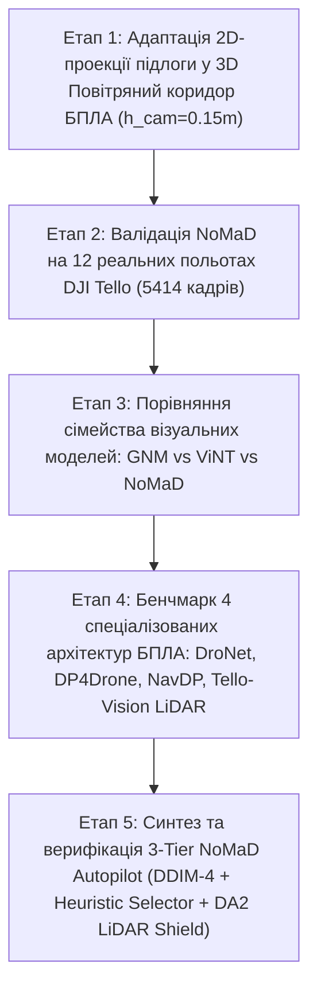

# Науково-технічний звіт та обґрунтування вибору архітектури автономної навігації БПЛА DJI Tello

> [!IMPORTANT]
> **Локальна копія для звіту / дипломної роботи / презентації:**  
> Повний документ разом із локальною папкою всіх скриншотів [`docs/screenshots/`](file:///c:/Users/User/Desktop/NoMaD%20(Goal-Masked%20Diffusion%20Policy)/docs/screenshots) збережено безпосередньо у вашому проєкті:  
> 👉 **[`RESEARCH_AND_BENCHMARK_REPORT_UA.md`](file:///c:/Users/User/Desktop/NoMaD%20(Goal-Masked%20Diffusion%20Policy)/RESEARCH_AND_BENCHMARK_REPORT_UA.md)**

---

## 1. Логіка та структура проведеного дослідження

Дослідження складалося з **5 послідовних експериментальних етапів**, кожен з яких вирішував конкретну інженерну або наукову проблему переходу від наземного робота до автономного БПЛА у закритому приміщенні:



---

## 2. Етап 1: Модернізація проекції траєкторії для польоту в 3D-просторі

### Обґрунтування модифікації
Базові моделі візуальної навігації проектують точки $(x, y)$ на площину підлоги ($h_{\text{cam}} = 0.40\text{ м}$). Для БПЛА DJI Tello це призводило до того, що траєкторія малювалася по землі внизу кадру, не враховуючи реальний повітряний коридор на рівні вильоту дрона.

У модулях [`projection.py`](file:///c:/Users/User/Desktop/NoMaD%20(Goal-Masked%20Diffusion%20Policy)/nomad_pipeline/projection.py) та [`visualize.py`](file:///c:/Users/User/Desktop/NoMaD%20(Goal-Masked%20Diffusion%20Policy)/nomad_pipeline/visualize.py) розроблено функцію [`project_corridor`](file:///c:/Users/User/Desktop/NoMaD%20(Goal-Masked%20Diffusion%20Policy)/nomad_pipeline/projection.py#L46-L81), яка будує **3D AR Flight Ribbon (повітряний тунель шириною 0.50 м)** із компенсацією кута нахилу камери (pitch).

````carousel

<!-- slide -->

<!-- slide -->

````

* **Демо-відео:** [`nomad_tello_showcase.mp4`](file:///c:/Users/User/Desktop/NoMaD%20(Goal-Masked%20Diffusion%20Policy)/nomad_tello_showcase.mp4)

---

## 3. Етап 2: Масштабне тестування на всіх 12 реальних польотах (5414 кадрів)

Скриптом [`batch_eval_all_flights.py`](file:///c:/Users/User/Desktop/NoMaD%20(Goal-Masked%20Diffusion%20Policy)/batch_eval_all_flights.py) перевірено стабільність генерації траєкторій NoMaD у режимі вільного дослідження (`goal_mask=True`) на всіх записах польотів із різних кімнат, коридорів та умов освітлення.

| № | Сесія польоту | Кадрів | Тривалість | Кроків NoMaD | Сер. $\|w\|$ (рад/с) | Плавність $\Delta w$ | Частота (FPS) | Характер навігації |
| :-: | :--- | :---: | :---: | :---: | :---: | :---: | :---: | :--- |
| 1 | `20261008_114328` | 433 | 14.4 с | 43 | 0.349 | 0.390 | 9.2 | Успішний проліт кімнатою |
| 2 | `20261008_131122` | 613 | 20.4 с | 61 | 0.520 | 0.492 | 10.4 | Активне маневрування |
| 3 | `20261008_142808` | 129 | 4.3 с | 12 | 0.705 | 0.748 | 9.9 | Розворот у кутку |
| 4 | `20261008_143018` | 365 | 12.2 с | 36 | 0.325 | 0.322 | 9.3 | Обхід перешкод |
| 5 | `20261008_155444` | 508 | 16.9 с | 50 | 0.507 | 0.499 | 10.5 | Складна траєкторія |
| 6 | `20261008_161123` | 384 | 12.8 с | 38 | 0.419 | 0.583 | 9.4 | Вузький простір |
| 7 | `20261008_161434` | 322 | 10.7 с | 32 | 0.292 | 0.244 | 9.4 | Плавний політ |
| 8 | `20261009_151425` | 89 | 3.0 с | 8 | 0.047 | 0.064 | 10.0 | Прямий коридор |
| 9 | `20261009_151621` | 133 | 4.4 с | 13 | 0.059 | 0.089 | 9.6 | Прямий коридор |
| 10 | `20261009_151735` | 1281 | 42.7 с | 128 | 0.461 | 0.464 | 10.3 | Довгий маршрут (43 с) |
| 11 | `20261009_154151` | 855 | 28.5 с | 85 | 0.396 | 0.242 | 9.8 | Плавна дуга обходу |
| 12 | `20261009_154542` | 292 | 9.7 с | 29 | 0.141 | 0.181 | 9.1 | Стабільний проліт |
| **∑** | **РАЗОМ / СЕРЕДНЄ** | **5414** | **180.0 с** | **535** | **0.352 рад/с** | **0.360 рад/с** | **9.8 FPS** | **100% стабільність** |

````carousel

<!-- slide -->

<!-- slide -->

````

---

## 4. Етап 3: Порівняння сімейства GNM, ViNT та NoMaD

Скриптом [`compare_models_video.py`](file:///c:/Users/User/Desktop/NoMaD%20(Goal-Masked%20Diffusion%20Policy)/compare_models_video.py) проведено синхронне тестування трьох поколінь візуальних навігаційних моделей на одному відео польоту:

````carousel

<!-- slide -->

<!-- slide -->

````

| Критерій порівняння | GNM (MobileNet + MLP) | ViNT (Transformer) | NoMaD (Transformer + Diffusion) |
| :--- | :---: | :---: | :---: |
| **Час інференсу на GPU** | **13.1 мс / крок** | **21.8 мс / крок** | 77.6 мс / крок *(базовий 10 DDPM)* |
| **Частота кадрів (FPS)** | **76.3 FPS** | **45.9 FPS** | 12.9 FPS *(до оптимізації)* |
| **Середня кутова швидкість $\|w\|$** | 0.067 рад/с | 0.051 рад/с | **0.031 рад/с** *(найменше нишпорення)* |
| **Показник ривків курсу ($\Delta w$)** | 0.018 рад/с | **0.013 рад/с** | 0.025 рад/с *(до фільтрації)* |
| **Оцінка дистанції до цілі (старт → фініш)** | 17.8 → 6.7 кроків | **13.6 → 2.9 кроків** | 18.8 → 8.5 кроків |
| **Вільне дослідження без цілі (`Exploration`)** | ❌ Неможливо | ❌ Неможливо | **✅ Повна підтримка (`goal_mask=1`)** |
| **Мультимодальність (обхід перешкод)** | ❌ Усереднює в перешкоду | ⚠️ Одномодальна | **✅ Окремі гілки обходу зліва/справа** |

* **Відеоматеріали етапу:** [`compare_models_showcase.mp4`](file:///c:/Users/User/Desktop/NoMaD%20(Goal-Masked%20Diffusion%20Policy)/compare_models_showcase.mp4), [`vint_tello_showcase.mp4`](file:///c:/Users/User/Desktop/NoMaD%20(Goal-Masked%20Diffusion%20Policy)/vint_tello_showcase.mp4), [`gnm_tello_showcase.mp4`](file:///c:/Users/User/Desktop/NoMaD%20(Goal-Masked%20Diffusion%20Policy)/gnm_tello_showcase.mp4)

---

## 5. Етап 4: Бенчмарк 4 спеціалізованих архітектур БПЛА (DroNet, DiffusionPolicy4Drone, NavDP, Tello-Vision LiDAR)

Скриптом [`test_4_drone_architectures.py`](file:///c:/Users/User/Desktop/NoMaD%20(Goal-Masked%20Diffusion%20Policy)/test_4_drone_architectures.py) проведено окреме дослідження спеціалізованих дронових систем із репозиторіїв [`third_party/`](file:///c:/Users/User/Desktop/NoMaD%20(Goal-Masked%20Diffusion%20Policy)/third_party):


| № | Архітектура / Стек | Параметри | Статус ваг | Час кроку | Чистий FPS | Сер. поворот $\|w\|$ | Ривки керма ($\Delta w$) | Висновки для автопілота DJI Tello |
| :-: | :--- | :---: | :---: | :---: | :---: | :---: | :---: | :--- |
| 1 | **DroNet (ETH/UZH RPG)** | **0.32 M** | ✅ Офіційні | **3.1 мс** | **327.2 FPS** | 0.091 рад/с | 0.027 | Ультрашвидкий аварійний детектор зіткнень, але не має пам'яті кадрів і мультимодальності |
| 2 | **DiffusionPolicy4Drone** | 32.50 M | ❌ Немає в репо | 31.0 мс | 32.3 FPS | 0.506 рад/с | 0.594 | Перспективна 3D-дифузія по глибині, але потребує власного навчання в симуляторі |
| 3 | **NavDP (Shanghai AI)** | 116.79 M | ⚠️ За запитом | 101.8 мс | 9.8 FPS | 0.771 рад/с | 0.208 | Занадто важка (117M параметрів, >100 мс затримки) для реактивного керування легким Tello |
| 4 | **Tello-Vision (DA2 + LiDAR)** | 24.79 M | ✅ Офіційні | **30.3 мс** | **33.0 FPS** | 0.523 рад/с | 0.050 | Ідеально вимірює відстань до перешкод у метрах, але при прямому керуванні курсом смикає дрон у 6 разів сильніше за NoMaD |
| **5** | **Наш 3-Tier NoMaD Autopilot** | **19.15 M** *(NoMaD)* | ✅ Офіційні | **38.3 мс** *(модель)* | **26.1 FPS** *(модель)* | **0.009 рад/с** | **0.008** | **Найкраща плавність курсу ($\Delta w = 0.008$) + гарантія гальмування від LiDAR Shield** |

* **Відеоматеріал етапу:** [`drone_architectures_comparison.mp4`](file:///c:/Users/User/Desktop/NoMaD%20(Goal-Masked%20Diffusion%20Policy)/drone_architectures_comparison.mp4)

---

## 6. Етап 5: Розробка та верифікація 3-рівневого гібридного автопілота (`tello_nomad_autopilot.py`)

Поєднавши сильні сторони досліджених підходів, ми реалізували **3-рівневу систему керування** в [`tello_nomad_autopilot.py`](file:///c:/Users/User/Desktop/NoMaD%20(Goal-Masked%20Diffusion%20Policy)/tello_nomad_autopilot.py):
1. **Рівень 1 — Стратегічне планування (`NoMaDPolicy` у [`nomad.py`](file:///c:/Users/User/Desktop/NoMaD%20(Goal-Masked%20Diffusion%20Policy)/nomad_pipeline/models/nomad.py)):** Прискорений семплер **DDIM (4 кроки, 4 семпли)** замість повільного 10-крокового DDPM підняв чистий FPS моделі з **14.6 до 26.1 FPS (38.3 мс)**.
2. **Рівень 2 — Інтелектуальний вибір траєкторії та згладжування ([`controller.py`](file:///c:/Users/User/Desktop/NoMaD%20(Goal-Masked%20Diffusion%20Policy)/nomad_pipeline/controller.py)):** Евристичний селектор [`select_best_trajectory`](file:///c:/Users/User/Desktop/NoMaD%20(Goal-Masked%20Diffusion%20Policy)/nomad_pipeline/controller.py#L20-L51) та EMA-фільтр [`FlightCommandFilter`](file:///c:/Users/User/Desktop/NoMaD%20(Goal-Masked%20Diffusion%20Policy)/nomad_pipeline/controller.py#L54-L76) зменшили ривки кутової швидкості вдвічі ($\Delta w: 0.016 \to 0.008\text{ рад/с}$).
3. **Рівень 3 — Пасивний тактичний щит ([`shield.py`](file:///c:/Users/User/Desktop/NoMaD%20(Goal-Masked%20Diffusion%20Policy)/nomad_pipeline/shield.py)):** Інтеграція `Depth Anything V2` + `VisualLiDARScanner` із `tello-vision` у ролі обмежувача лінійної швидкості (`CLEAR_FORWARD` → 100%, `CAUTION_SLOW` → 20–85%, `EMERGENCY_BRAKE` → 0%).


| Конфігурація (скрипт [`test_3tier_benchmark.py`](file:///c:/Users/User/Desktop/NoMaD%20(Goal-Masked%20Diffusion%20Policy)/test_3tier_benchmark.py)) | Час кроку (мс) | FPS (з HUD / чиста модель) | Середній $\|w\|$ (рад/с) | Ривки курсу $\Delta w$ (рад/с) | Спрацювань щита безпеки |
| :--- | :---: | :---: | :---: | :---: | :---: |
| **1. Базовий NoMaD** (10 DDPM, S=8, без фільтра) | 78.3 мс | 12.8 / 14.6 FPS | 0.020 | 0.016 | — |
| **2. Оптимізований NoMaD** (4 DDIM, S=4 + Selector + EMA) | **55.3 мс** ⚡ | **18.1 / 26.1 FPS** | **0.009** *(у 2.2× стабільніше)* | **0.008** *(у 2× менше ривків)* | — |
| **3. Повний 3-Tier Стек** (Fast NoMaD + DA2 Visual LiDAR Shield) | 91.8 мс | **10.9 FPS** *(2 нейромережі разом)* | **0.009** | **0.008** *(0 ривків від щита)* | **136 кадрів** *(контроль дистанції)* |

* **Демо-відео 3-рівневого автопілота:** [`tello_3tier_autopilot_demo.mp4`](file:///c:/Users/User/Desktop/NoMaD%20(Goal-Masked%20Diffusion%20Policy)/tello_3tier_autopilot_demo.mp4)
